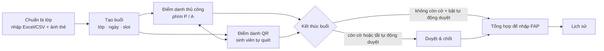
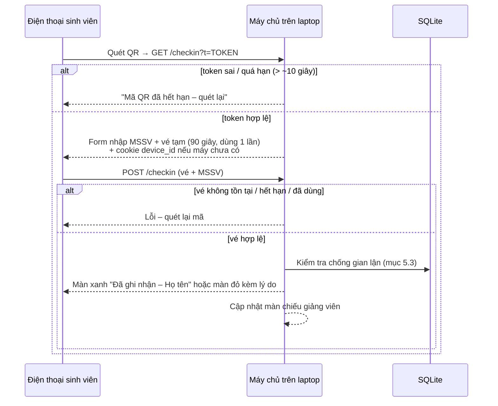
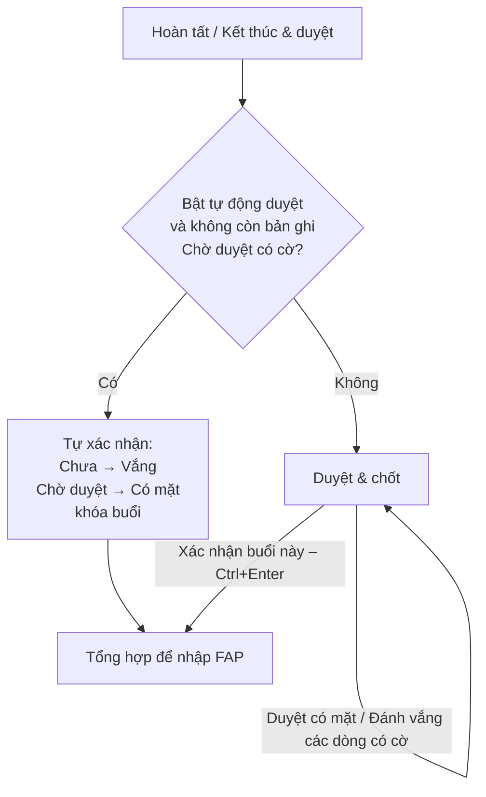
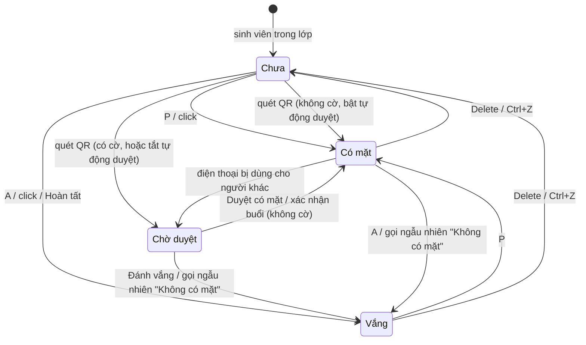

# Luồng hoạt động – Sổ điểm danh

Tài liệu mô tả ứng dụng làm gì ở từng bước, theo đúng code hiện tại.
Sơ đồ viết bằng Mermaid (xem được trên GitHub hoặc VS Code có extension Mermaid).

## 1. Tổng quan

Mọi dữ liệu lưu trong SQLite trên máy giảng viên
(`%APPDATA%\vn.edu.fpt\diem_danh\diem_danh.db`). Ảnh thẻ được copy vào
`%APPDATA%\vn.edu.fpt\diem_danh\photos\`. Ứng dụng không gửi gì lên FAP; giảng viên
tự nhập FAP từ màn Tổng hợp.

## 2. Chuẩn bị lớp

1. **Lớp học → Nhập từ Excel/CSV**, chọn file `.xlsx` hoặc `.csv`.
2. Ứng dụng tự tìm dòng tiêu đề và đoán cột:
   - MSSV: cột tên `MSSV`, `Mã SV`, `Roll Number`, `Code` (kiểu FAP)…
     Nếu không có tiêu đề, lấy cột có nhiều giá trị dạng `SE180001` nhất.
   - Họ tên: một cột `Họ tên`/`Full name`, hoặc ghép `Surname + Middle name + Given name`.
   - Mã lớp / mã môn / học kỳ đoán từ tên file (ví dụ `SE1801_PRN211.xlsx`);
     học kỳ mặc định theo ngày hiện tại (SP: tháng 1–4, SU: 5–8, FA: 9–12).
3. Hộp thoại cho xem 10 dòng đầu và báo số dòng **hợp lệ / lỗi / trùng MSSV**.
   Giảng viên sửa cột nếu cần rồi bấm **Nhập N sinh viên**.
4. Nhập lại file của cùng lớp (cùng mã lớp + mã môn + học kỳ): sinh viên mới được
   thêm, sinh viên đã có được cập nhật tên; ảnh thẻ giữ nguyên.
5. **Gắn thư mục ảnh thẻ**: chọn thư mục ảnh đặt tên theo MSSV
   (`SE180001.jpg` hoặc `SE180001_NguyenVanA.png`). Ảnh được copy vào dữ liệu ứng
   dụng; xóa thư mục gốc sau đó không ảnh hưởng. Sinh viên không có ảnh hiển thị
   2 chữ cái đầu (họ + tên).

## 3. Tạo buổi điểm danh

`Ctrl+N` hoặc nút **Điểm danh** trên thẻ lớp:

1. Chọn lớp, ngày (mặc định hôm nay), slot 1–8.
2. Chọn **Điểm danh thủ công** hoặc **Điểm danh bằng QR**.
3. Mỗi (lớp, ngày, slot) chỉ có một buổi. Nếu đã có → hỏi **Mở lại buổi cũ**;
   buổi đã xác nhận sẽ được mở lại để sửa.

Một buổi có thể dùng cả hai cách: đang thủ công bấm **Chuyển QR**, đang QR bấm
**Kết thúc** rồi quay lại sửa tay.

## 4. Điểm danh thủ công

Mỗi sinh viên ở một trong các trạng thái: **Chưa** · **Có mặt** · **Vắng** ·
**Chờ duyệt** (chỉ có từ QR).

| Phím | Tác dụng |
|---|---|
| `P` / `A` | Có mặt / Vắng, rồi tự sang người tiếp theo |
| `Space`, `↓`, `→` / `↑`, `←` | Sang người tiếp / quay lại (không đánh dấu) |
| `Delete` | Xóa đánh dấu (về Chưa) |
| `/` hoặc `Ctrl+F` | Tìm theo MSSV hoặc tên (không dấu cũng được); `Enter` nhảy tới kết quả đầu, `Esc` quay lại danh sách |
| `F` | Chế độ tập trung: ảnh lớn một người để đối chiếu mặt |
| `Ctrl+Z` | Hoàn tác thao tác gần nhất (nhiều lần được) |
| `Ctrl+Enter` | Hoàn tất |

- Chuột: click thẻ xoay vòng Chưa → Có mặt → Vắng → Chưa; chuột phải để chọn
  trạng thái hoặc thêm ghi chú.
- Hiển thị dạng **Lưới** (thẻ sinh viên) hoặc **Bảng**; lọc **Tất cả / Chưa / Vắng**.
- Phím tắt không chạy khi con trỏ đang ở ô nhập liệu.
- Mỗi thao tác được ghi ngay vào CSDL, tắt ứng dụng giữa chừng không mất dữ liệu.

**Hoàn tất**: nếu còn người "Chưa" → hỏi *Đánh dấu tất cả còn lại là Vắng?*, rồi
sang bước kết thúc (mục 6).

## 5. Điểm danh bằng QR

### 5.1. Phía giảng viên

1. Mở buổi ở chế độ QR → ứng dụng:
   - tạo khóa bí mật ngẫu nhiên 32 byte (chỉ nằm trong bộ nhớ, mỗi buổi một khóa);
   - mở máy chủ web trên cổng 8080 (đổi được trong Cài đặt) ở mọi card mạng;
   - chọn IP mạng LAN (ưu tiên hotspot Windows `192.168.137.x`), có thể đổi bằng
     cách bấm vào địa chỉ trên màn chiếu.
2. Màn chiếu (luôn nền sáng): tên/mật khẩu Wi-Fi (nhập trong Cài đặt), QR lớn,
   thanh đếm ngược tới lần đổi mã, bộ đếm `đã điểm danh / sĩ số`, danh sách
   **Vừa điểm danh** (dòng có cờ tô vàng kèm lý do).
3. Nút: **Tạm dừng** (ẩn QR, máy chủ từ chối mọi lượt quét) · **Toàn màn hình** (F11) ·
   **Ẩn danh sách khi chiếu** · **Gọi ngẫu nhiên** · **Kết thúc & duyệt**.
4. **Kết thúc** tắt máy chủ, xóa khóa bí mật và mọi vé tạm, rồi sang mục 6.

### 5.2. Phía sinh viên

- **Token xoay vòng:** `window = floor(unix_millis / 5000)`,
  `token = 16 ký tự hex đầu của HMAC-SHA256(khóa, "buổi:window")`. Máy chủ chấp
  nhận token của khung hiện tại và khung liền trước (tối đa ~10 giây), so sánh
  thời gian hằng. Chu kỳ đổi mã chỉnh trong Cài đặt (tối thiểu 3 giây).
- **Vé tạm** giải quyết việc "đang gõ MSSV thì QR đổi": có vé là gõ thoải mái
  trong 90 giây, nhưng vé chỉ dùng được một lần.
- Trang điện thoại là HTML thuần, tiếng Việt, không tải gì từ Internet (hotspot
  có thể không có mạng).

### 5.3. Kiểm tra chống gian lận (theo thứ tự)

| # | Tình huống | Kết quả | Hiển thị cho giảng viên |
|---|---|---|---|
| 1 | MSSV không có trong lớp | Từ chối: *"MSSV … không có trong lớp"* | – |
| 2 | MSSV đã điểm danh buổi này (hoặc đã bị xác nhận vắng khi gọi ngẫu nhiên) | Từ chối: *"Bạn đã điểm danh rồi"* | – |
| 3 | Điện thoại này đã điểm danh cho **người khác** trong buổi | **Từ chối**; bản ghi của người đầu tiên bị gắn cờ *Thiết bị đã dùng cho người khác* và đưa về **Chờ duyệt** | Dòng cảnh báo vàng trong danh sách trực tiếp |
| 4 | MSSV từng dùng điện thoại **khác** ở các buổi trước | Ghi nhận, gắn cờ *Đổi thiết bị* | Dòng vàng |
| 5 | Không có cookie (chặn cookie, duyệt ẩn danh) | Ghi nhận, gắn cờ *Không nhận diện được thiết bị* | Dòng vàng |
| 6 | Hợp lệ, không cờ | Ghi nhận | Dòng thường |

Trạng thái bản ghi được ghi nhận:

- **Bật "Tự động duyệt khi không có cờ"** (mặc định): không cờ → **Có mặt**;
  có cờ → **Chờ duyệt**.
- **Tắt**: mọi lượt QR → **Chờ duyệt** (đúng spec gốc).

Các yêu cầu cùng lúc được xử lý tuần tự, nên hai lượt gửi gần như đồng thời từ
một điện thoại không thể cùng lọt qua kiểm tra số 3.

### 5.4. Gọi ngẫu nhiên

Chọn ngẫu nhiên 3–5 sinh viên đã điểm danh (ưu tiên người điểm danh bằng QR),
hiện ảnh lớn. Giảng viên gọi tên:

- **Có mặt** → bản ghi thành Có mặt.
- **Không có mặt** → bản ghi thành **Vắng** + cờ *Không có mặt khi gọi tên*;
  sinh viên này không thể tự quét QR để điểm danh lại.

## 6. Kết thúc buổi

**Duyệt & chốt**

- Bảng toàn lớp: ảnh, MSSV, họ tên, trạng thái, cách điểm danh, giờ, cờ.
- Lọc nhanh **Tất cả · Có cờ · Chờ duyệt · Vắng**; mở sẵn **Có cờ** nếu có.
- Chọn nhiều dòng → **Duyệt có mặt** / **Đánh vắng**.
- **Xác nhận buổi này** bị khóa khi còn bản ghi *Chờ duyệt có cờ*. Khi xác nhận:
  người còn "Chưa" → hỏi đánh Vắng; *Chờ duyệt* không cờ → Có mặt; buổi được khóa.

## 7. Tổng hợp để nhập FAP

- Hai cột: **Vắng** (viền đỏ, ở trước) và **Có mặt**, theo thứ tự danh sách lớp.
- **Copy danh sách vắng**: mỗi MSSV một dòng, dán vào FAP.
- **Xuất CSV**: file UTF-8 có BOM (Excel đọc đúng tiếng Việt) gồm STT, lớp, môn,
  ngày, slot, MSSV, họ tên, trạng thái, cách điểm danh, giờ, cờ.
- Ô **Đã cập nhật lên FAP**: giảng viên tự tích sau khi nhập FAP.
- **Sửa lại buổi này**: mở khóa buổi và quay về điểm danh thủ công.

## 8. Lịch sử

Danh sách mọi buổi: ngày, slot, lớp, có mặt/sĩ số, số vắng, trạng thái
(*Đang mở* / *Đã xác nhận*), đồng bộ Google Sheets, đã nhập FAP. Bấm một dòng:
buổi đã xác nhận → Tổng hợp; buổi đang mở → Điểm danh thủ công.

Tỉ lệ vắng của từng sinh viên (trang Chi tiết lớp) chỉ tính trên các buổi **đã
xác nhận**; từ ngưỡng cảnh báo (mặc định 20%, chỉnh trong Cài đặt) trở lên thì tô
bút đỏ.

## 9. Vòng đời một bản ghi điểm danh

## 10. Chưa làm (các giai đoạn sau)

- **Giai đoạn 5 – Google Sheets:** đăng nhập Google, đồng bộ các buổi đã xác nhận
  vào sheet `Attendance_Logs` (ghi theo lô, thử lại khi mất mạng, không tạo trùng).
  Hiện cột "Google Sheets" trong Lịch sử luôn là *Chưa kết nối*.
- **Giai đoạn 6:** khôi phục buổi QR đang chạy khi mở lại ứng dụng, hướng dẫn sử
  dụng trong app, đóng gói `.msix`.
