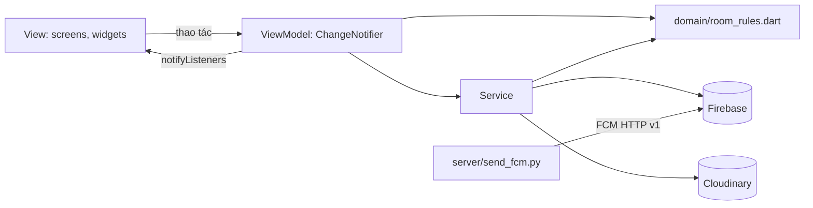

# Kiến trúc

Hai ứng dụng Flutter theo **MVVM + Provider**, dùng chung model và Firestore: app Android cho sinh viên (`lib/main.dart`) và web cho giảng viên (`lib/main_admin.dart`). Đường dẫn tính từ `flutter_app/`.

## Trách nhiệm từng lớp
| Lớp | Thư mục | Được làm | Không được làm |
|---|---|---|---|
| View | `lib/screens`, `lib/widgets` | Vẽ state, chuyển thao tác | Gọi Firebase, chứa luật nghiệp vụ |
| ViewModel | `lib/viewmodels` | Giữ state tải/dữ liệu/rỗng/lỗi, gọi service | Import `material.dart` |
| Service | `lib/services` | Gọi Firebase và dịch vụ ngoài | Biết về widget |
| Domain | `lib/domain` | Luật thuần, dễ unit test | Phụ thuộc Firebase |
| Model | `lib/models` | Dữ liệu và chuyển đổi Firestore | Gọi dịch vụ |

## Phụ thuộc giữa các thành phần
| ViewModel | Service dùng | Màn hình |
|---|---|---|
| `AuthViewModel` | Auth, User, Analytics, Crashlytics, Notification | `AuthGate`, Login, Điều khoản |
| `SpaceViewModel` | Group, RemoteConfig, Analytics, Crashlytics | Danh sách Room, Nhóm, Đơn, Chi tiết đơn |
| `RoomDetailViewModel` | Group, Analytics, Crashlytics | Chi tiết Room |
| `ProfileViewModel` | User, Group, DemoSeed, RemoteConfig, Analytics, Crashlytics | Hồ sơ |
| `ReportViewModel` | Group, Report, FileStorage, ReportPdfBuilder, Analytics, Crashlytics | Xuất báo cáo |
| `NotificationViewModel` | Notification | Trung tâm thông báo |
| `AdminViewModel` | Auth, User, Admin | Web giảng viên (`screens/admin/`) |

Service được tạo một lần trong `main.dart` và đưa xuống bằng `Provider`. Trong test, `GroupService` dùng `fake_cloud_firestore`; các service khác có factory `.disabled()`.

## Dữ liệu Firestore
| Đường dẫn | Nội dung |
|---|---|
| `users/{uid}` | Hồ sơ, 5 kỹ năng, cam kết, điều khoản |
| `users/{uid}/fcm_tokens/{token}` | Token của từng thiết bị |
| `users/{uid}/reports/{id}` | Metadata báo cáo PDF |
| `spaces/{term_course}` | Cấu hình môn trong kỳ |
| `rooms/{roomCode}` | Thành viên, Leader, trạng thái |
| `rooms/{roomCode}/elections/{id}` | Bầu Leader |
| `memberships/{spaceId_uid}` | Sinh viên đang ở Room nào |
| `applications/{id}` | Đơn Apply và phiếu vote |
| `transfer_requests/{id}` | Yêu cầu chuyển nhóm |
| `crash_logs/{id}` | Tóm tắt sự cố cho web giảng viên |
| `enrollments/{spaceId}_{MSSV}` | Danh sách FAP của từng môn (BR-01) |

## Các luồng chính
- **Vào Room hoặc nhận ứng viên:** chạy transaction đọc Room và membership rồi mới ghi, để không vượt sĩ số và không vào hai nhóm. Tự Cancel và Reject đơn (BR-26, BR-28) chạy batch ngay sau transaction, vì transaction không chạy query được. Nếu mất mạng giữa hai bước, đơn có thể chưa đổi trạng thái; khi Leader nhận ứng viên đã có nhóm, `decideApplication` sẽ tự Cancel đơn đó.
- **Thông báo:** app lấy token, lưu Firestore; `server/send_fcm.py` đọc token bằng Admin SDK và gọi FCM. Khóa service account nằm ngoài repo.
- **Phân phối sinh viên lẻ:** `DistributionPlanner` lập kế hoạch thuần Dart để giảng viên xem trước; `applyDistribution` ghi trong transaction và dừng nếu dữ liệu vừa đổi.
- **Import danh sách FAP:** `RosterParser` đọc CSV/`.xlsx` thuần Dart, `RosterDiff` so với danh sách đang lưu để giảng viên xem trước; `importRoster` ghi danh sách, cập nhật số sinh viên và tạo thêm Room còn thiếu. Bộ đọc `.xlsx` tự viết vì các thư viện Excel xung đột với `pdf` về phiên bản `xml`.
- **Báo cáo:** tạo PDF trong app, upload Cloudinary bằng unsigned preset, lưu URL vào Firestore.

## Giới hạn đã biết
- Ngưỡng, sĩ số, giới hạn Apply chỉ kiểm tra ở client; Rules chỉ kiểm tra quyền. Muốn chặn gian lận hoàn toàn cần chuyển lên Cloud Functions hoặc backend.
- Sinh viên có tên trong danh sách FAP nhưng chưa từng đăng nhập thì chưa có `uid`, nên trang Phân phối chưa xếp được; trang Danh sách hiện họ là "Chưa vào môn".
- BR-01 chỉ kiểm tra ở client, chưa có trong Rules. Mẫu file FAP thật chưa được đối chiếu: bộ đọc nhận cột theo tên và chưa đọc được `.xls` cũ.
- Web đọc sự cố từ `crash_logs` do app tự ghi, không phải từ Crashlytics. Crash chỉ ghi được khi người dùng mở lại app và đã đăng nhập.
- Web không xem được Analytics; số liệu Analytics vẫn xem trên Firebase Console.
- `isDemoAdmin()` trong Rules chỉ để tạo dữ liệu demo, phải xóa trước khi nộp.
